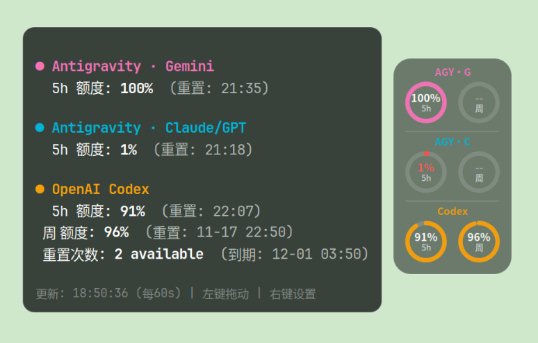

# QuotaPill

A lightweight floating **AI quota ring widget for Linux**. Displays remaining quota for **OpenAI Codex** and **Google Antigravity** (Gemini / Claude-GPT groups), including reset details, a translucent pill UI, drag-to-move, hover details, and right-click appearance controls.



## Features

- Four layouts, compact/mini scales, 16 color presets plus custom color chooser.
- Independently customizable pill/card opacity, low-quota warning, always-on-top toggle.
- Selectable refresh interval (30–600 seconds) and last-known-good offline cache.
- Multiple-monitor positioning; XWayland-based rendering on GNOME Wayland.
- Codex JSON usage parsing; Antigravity CLI text parsing (upstream format may change).
- Installer preserves all existing CodexBar settings, accounts and other enabled providers.

## Requirements

Ubuntu or Debian Linux, GTK3, PyGObject, Cairo, X11 or an XWayland-enabled Wayland session, and the [CodexBar CLI](https://github.com/steipete/CodexBar).

## Install

```bash
git clone https://github.com/lbg2002/quota-pill.git
cd quota-pill
./install.sh
```

The installer uses APT for missing GTK dependencies. If CodexBar CLI is missing, it downloads an official GitHub release archive **with SHA-256 verification**, without executing third-party installers. It installs QuotaPill only into your home directory and enables login autostart by default. Use `--no-autostart` or `--no-start` to change this.

First ensure the upstream CLI can access your signed-in providers:

```bash
codexbar usage --provider codex --format json
codexbar usage --provider antigravity --no-color
```

Run `~/.local/bin/quota-pill`, hover for details, left-click and drag to move, or right-click for settings. The ring reports **remaining** quota; `--` means missing/unavailable data, not zero.

This is a **floating overlay**, not a native GNOME Shell panel extension. Window stacking and pinning depend on the compositor. It is not affiliated with Google or OpenAI.

## Uninstall

```bash
./uninstall.sh
```

Only the program and its autostart entry are removed. Your settings, cache, shared CodexBar CLI and account/authentication state are preserved.

## Development

```bash
bash -n install.sh uninstall.sh
python3 -m py_compile quota_pill.py
python3 -m unittest discover -s tests -v
```

Report issues with your distro, desktop session, CodexBar CLI version and **redacted** logs. Do not submit tokens, cookies or authentication files.

## License

MIT License for QuotaPill. CodexBar is a separate upstream project governed by its own license and terms.

中文说明：[README.md](README.md)
