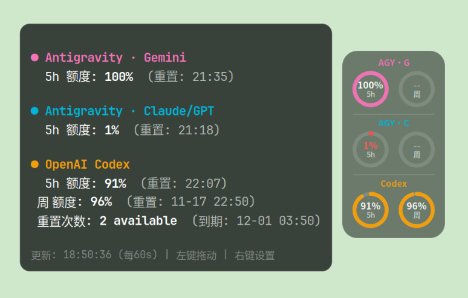
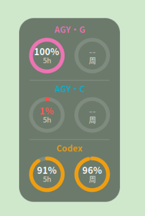
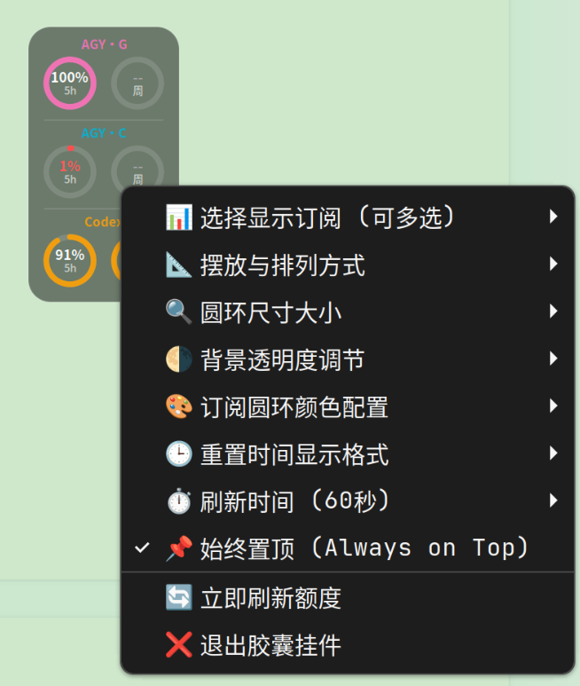

# QuotaPill

**为 Linux 桌面打造的轻量 AI 额度圆环挂件。** 通过一个可拖动的半透明胶囊，查看 **Google Antigravity（Gemini / Claude・GPT）** 与 **OpenAI Codex** 的剩余额度、重置时间和状态。鼠标悬停查看详情，右键即可调整外观与显示方式。

> QuotaPill 是独立的社区项目，**并非 Google 或 OpenAI 官方产品**。配额数据来自 [CodexBar CLI](https://github.com/steipete/CodexBar)，本项目只负责本地读取与桌面显示。



<p align="center"> </p>

## 功能

- **额度圆环**：显示 Codex、Antigravity Gemini、Antigravity Claude/GPT；分别显示当前窗口和周窗口（存在时）。
- **完整悬停详情**：剩余额度、配额重置时间、Codex 重置次数（上游提供时）。
- **四种排列**：顶栏横排、多列、逐订阅横排、单列竖排。
- **两种尺寸**：紧凑版和超迷你版；迷你顶栏模式是**浮动覆盖**，不是 GNOME Shell 原生扩展。
- **外观自定义**：16 种预设颜色、自定义系统色轮、胶囊和详情卡透明度、20% 低额度提醒。
- **快捷操作**：拖动位置、右键设置、手动刷新、置顶切换、退出。
- **刷新与缓存**：可选 30 秒～10 分钟刷新；失败时保留上次有效数据并标记缓存/错误。
- **多显示器定位**：支持常见的负坐标屏幕布局及显示器配置变更后的窗口纠正。
- **保护本机设置**：安装脚本**不修改** CodexBar 已有配置、登录状态或其他 providers。

## 系统要求

| 项目 | 需求 |
| --- | --- |
| 操作系统 | Ubuntu / Debian Linux（安装脚本使用 APT） |
| 桌面 | GTK3 图形桌面；GNOME 推荐 |
| 图形会话 | X11，或支持 XWayland 的 Wayland 会话 |
| Python | 系统 Python 3，`python3-gi`、`python3-cairo`、`gir1.2-gtk-3.0` |
| 数据后端 | [CodexBar CLI](https://github.com/steipete/CodexBar/releases)；需有相应账号登录/数据来源 |
| 架构 | 官方 CLI 自动安装目前支持 x86_64、aarch64 |

**注意：** GNOME Wayland 下本程序通过 XWayland 创建独立悬浮窗口。置顶、拖拽、弹窗和顶栏覆盖效果取决于窗口管理器，不能保证在所有桌面环境中表现完全一致。无 XWayland 时无法启动。

## 安装

```bash
git clone https://github.com/lbg2002/quota-pill.git
cd quota-pill
./install.sh
```

安装程序会安装缺失的 GTK/Cairo APT 依赖。若找不到 CodexBar CLI，会从 **steipete/CodexBar 官方 GitHub Release** 下载当前 Linux CLI，并验证官方 `.sha256` 校验文件后安装到用户目录。**不执行第三方安装脚本，也不会覆盖现有 `codexbar` 命令。**

用户文件安装路径：

- `~/.local/bin/quota-pill`：主程序
- `~/.config/quota-pill/config.json`：挂件配置
- `~/.cache/quota-pill/`：日志与额度缓存
- `~/.config/autostart/quota-pill.desktop`：登录自启项

使用已有的系统/自定义 CodexBar 安装也可以：程序优先查找 PATH 中的 `codexbar`，或接受 `QUOTA_PILL_CODEXBAR=/绝对路径/codexbar` 环境变量。

### 安装选项

```bash
./install.sh --no-autostart # 不启用登录自启动
./install.sh --no-start     # 安装完不立即启动
./install.sh --skip-deps    # 已自行准备 GTK3/Cairo 环境时跳过依赖安装
```

**账号/额度准备：** 先使用对应客户端完成登录，并确认本机 CodexBar CLI 能够读取所需额度：

```bash
codexbar usage --provider codex --format json
codexbar usage --provider antigravity --no-color
```

如果这里已经无法显示额度，QuotaPill 也无法代替上游完成登录或破解权限。Antigravity 数据可能要求客户端或它的本地数据源正在运行；部分模型或周期没有上游数值时显示 `--`，不等于额度为零。

## 使用

安装完成后通常会自动启动，也可以执行：

```bash
~/.local/bin/quota-pill
```

**左键拖动**胶囊；**鼠标悬停**查看完整数据；**右键**打开设置菜单。配置自动保存在 `~/.config/quota-pill/config.json`。

**额度含义：** 圆环展示 **剩余额度百分比**（不是已使用百分比），`0%` 为耗尽，`--` 表示未知/不可用。Codex 优先使用 CLI 的 JSON 输出并转换 `usedPercent → remainingPercent`；Antigravity 当前采用 CLI 文本格式解析，升级上游后如发生格式变化可能需要调整。

**时间格式：** 可以在右键菜单中选择相对时间、绝对 `HH:MM` 或跨天含日期。JSON 的 `resetsAt` 时间戳按本机时区展示；文本源缺少可计算时间时保留原文。

**自定义刷新：** 默认每 60 秒；读取失败保留上一条有效数据，并在详情中标识缓存，避免把网络失败误判为 0% 额度。

## 卸载

在克隆的源码目录执行：

```bash
./uninstall.sh
```

卸载只会移除 QuotaPill 可执行文件与登录自启动文件，**不会卸载其他软件可能共用的 CodexBar CLI**，也不会删除它的账号和认证信息。为避免丢失用户设置，`~/.config/quota-pill` 与 `~/.cache/quota-pill` 默认保留，可在确认不再需要后手动删除。

## 故障排查

**启动无界面：** 确保正在图形会话中，并且已安装 GTK3、Cairo 与 XWayland；参见 `~/.cache/quota-pill/startup.log`。

**额度显示 `--`：** 首先运行上面的两条 `codexbar usage` 命令，检查上游是否返回数据；再检查 `~/.cache/quota-pill/quota-pill.log`。部分额度无法获取并不意味着额度耗尽。

**Wayland 窗口无法置顶：** XWayland / GNOME 对独立浮动窗口的管理因环境而异；这不是 GNOME Shell 扩展，也不会修改顶栏进程。

**升级：** 拉取本仓库的更新后再次运行 `./install.sh`。脚本不会重写你的 CodexBar provider 配置。

## 项目文件

```text
quota-pill/
├── quota_pill.py            # GTK3 + Cairo 挂件程序
├── install.sh               # 安全安装与自启设置
├── uninstall.sh             # 卸载（保留用户数据）
├── assets/                  # 应用界面截图
├── tests/                   # 无需图形环境的解析单元测试
├── .github/workflows/       # 代码静态检查
├── README.md
├── README.en.md
├── LICENSE
└── .gitignore
```

## 开发、测试与反馈

```bash
bash -n install.sh uninstall.sh
python3 -m py_compile quota_pill.py
python3 -m unittest discover -s tests -v
```

欢迎通过 Issues 反馈具体系统版本、桌面/XWayland 环境、CodexBar CLI 版本、日志中已脱敏的错误信息。**不要上传 API Key、Cookie、OAuth Token 或完整认证文件。**

## 致谢与许可

- 额度来源：[CodexBar](https://github.com/steipete/CodexBar)（请遵守上游自己的许可与服务条款）
- GTK3 / PyGObject / Cairo
- QuotaPill 本项目：**MIT License**，见 [LICENSE](LICENSE)

---

**English documentation:** [README.en.md](README.en.md)
